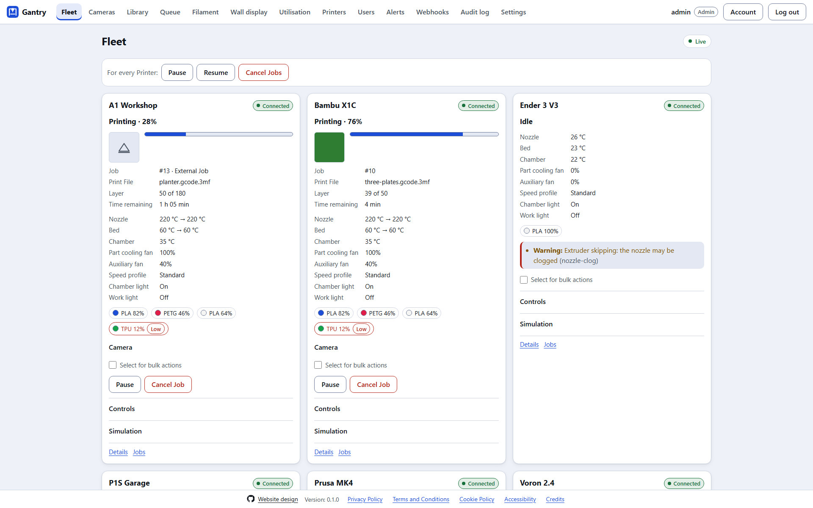
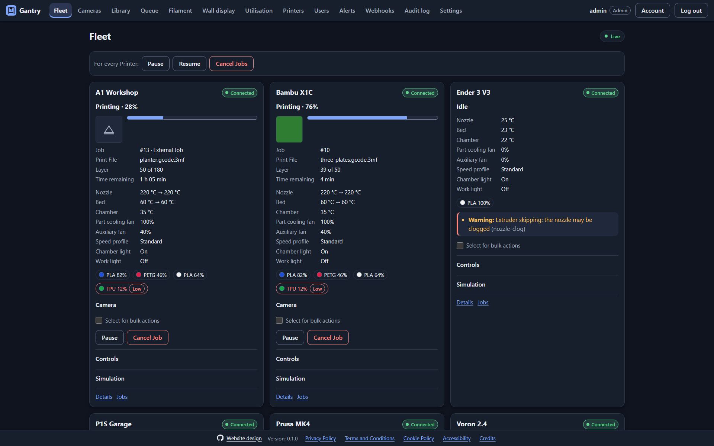
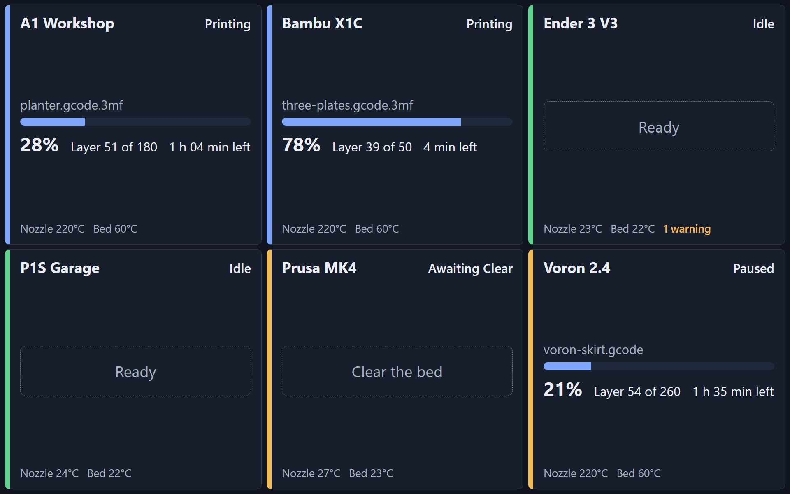
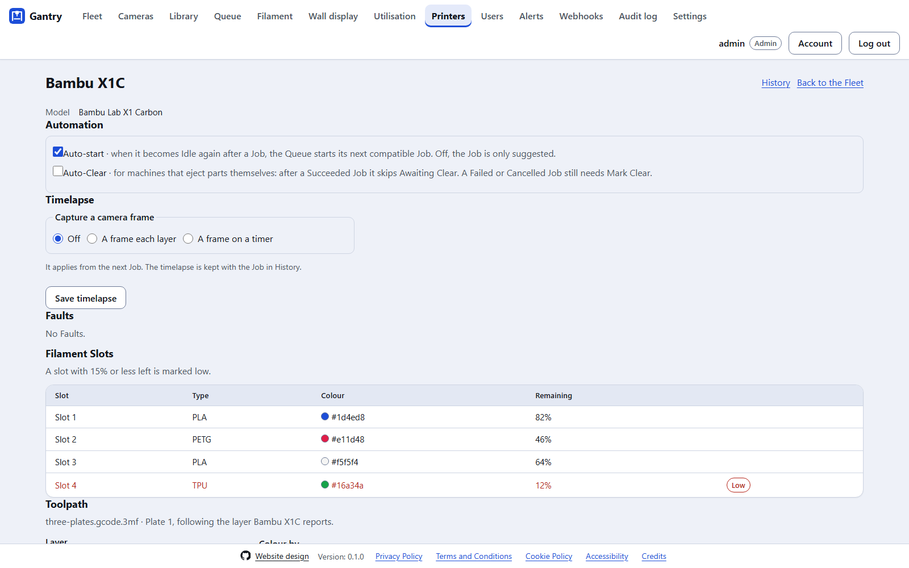
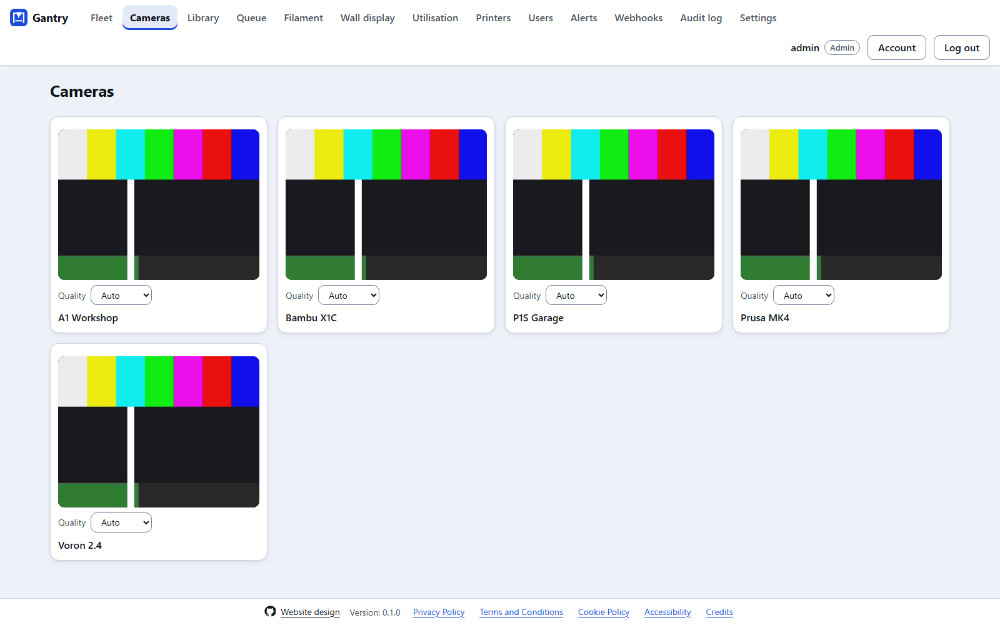
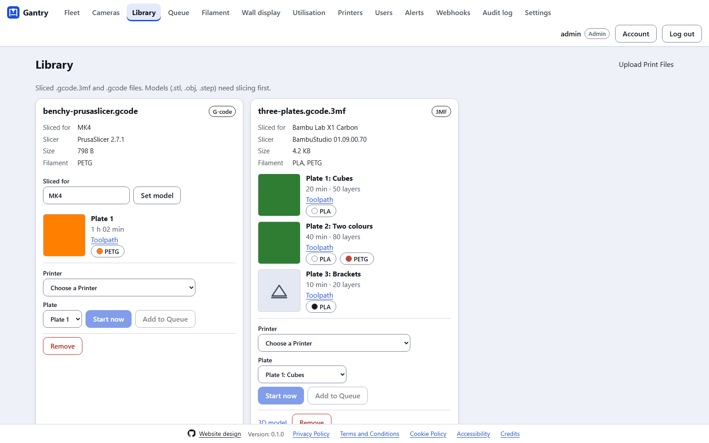
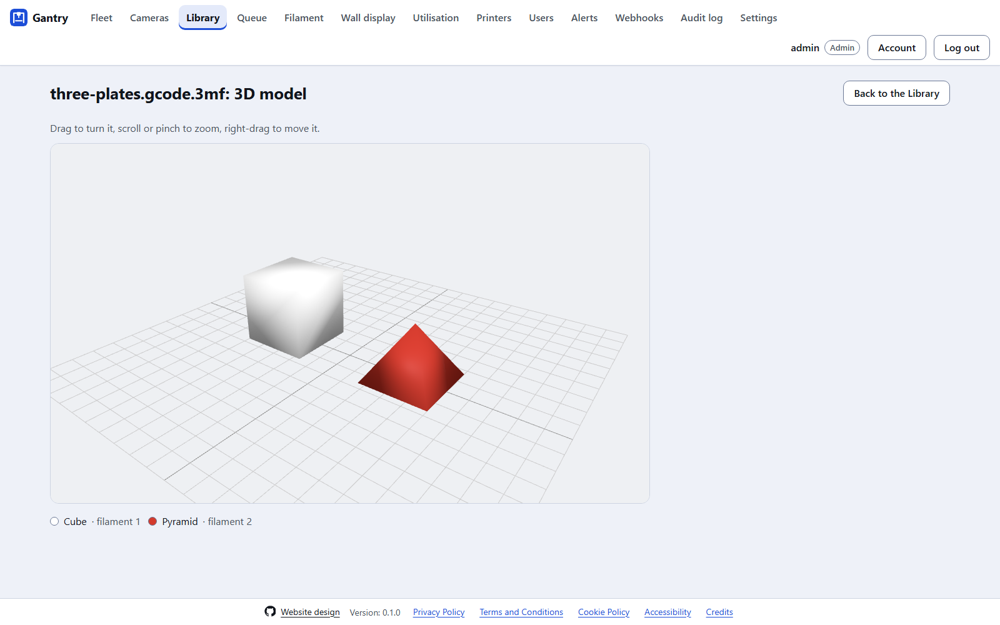
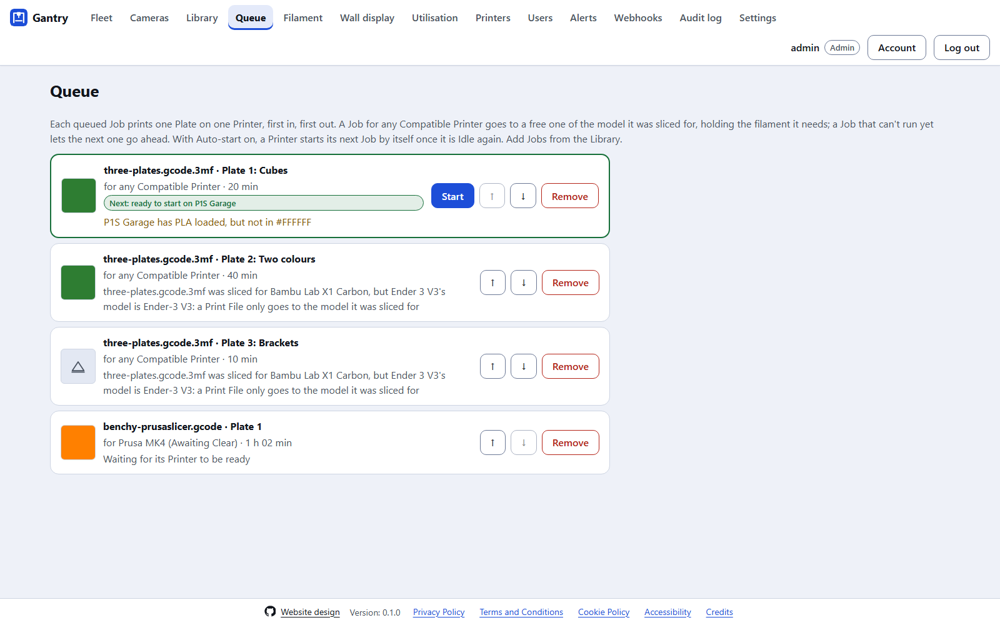

<p align="center">
  
</p>

<h1 align="center">Gantry</h1>

<p align="center">
  <strong>A self-hosted dashboard for monitoring and controlling a fleet of 3D printers from one screen.</strong>
</p>

<p align="center">
  <a href="https://gantry.adrianeyre.co.uk">Website</a> ·
  <a href="https://github.com/adrianeyre/gantry/releases/latest">Download</a> ·
  <a href="docs/getting-started.md">Getting started</a> ·
  <a href="docs/">Documentation</a>
</p>

Gantry is a single Rust binary that runs on an always-on machine on your home or workshop network (a Raspberry Pi, mini PC or NAS). It talks to each printer over the LAN and serves a login-protected website, so you can watch and control every printer from any browser, at home or away. There are desktop apps for Windows, macOS and Linux too, and no vendor cloud is involved.



> **Status: development complete; real-printer validation to come.** Every phase is built and works end to end with Simulated Printers. Seven Drivers are built and tested against simulators and mock servers, but **no real printer has tried any of them yet** ([roadmap](docs/roadmap.md)). CI runs on every pull request, and each merge to `main` is released automatically.

---

## Contents

- [Features](#features)
- [Screenshots](#screenshots)
- [Supported printers](#supported-printers)
- [Quick start](#quick-start)
- [Downloads](#downloads)
- [How it works](#how-it-works)
- [Security](#security)
- [Documentation](#documentation)
- [Contributing](#contributing)

## Features

- **Live status of every Printer on one screen:** Connection, Printer State, progress, layer, time remaining, temperatures, fans, Filament Slots, Faults and a camera view, plus a camera grid and a wall display.
- **Control:** pause, resume and Cancel (with confirmation), temperatures, lights, fans, speed profiles, homing, jogging and filament load and unload. Bulk actions report each Printer's result.
- **Print management:** a Print File library with Plate thumbnails, an interactive 3D model viewer, and a toolpath preview with live layer tracking.
- **A Queue that won't print onto an occupied bed:** a Job names a Printer or runs on any Compatible Printer, and after every Job a Printer waits in *Awaiting Clear* until someone uses *Mark Clear*. Auto-start and Auto-Clear per Printer.
- **Alerts** through ntfy, Discord, email, Telegram and desktop notifications, as Fleet-wide Alert Rules.
- **History, analytics and timelapses:** Job Outcomes, success rates, filament use and cost, utilisation, and a timelapse of each Job.
- **Finds your Printers:** Bambu, Moonraker and OctoPrint Printers on the LAN are offered to an Admin to add.
- **For other tools:** a [REST API](docs/rest-api.md) with API tokens, signed [webhooks](docs/webhooks.md) and [Prometheus metrics](docs/metrics.md).
- **Secure by default:** a login always, Viewer, Operator and Admin roles, TOTP and passkeys, lockouts, an audit log, and encrypted credentials.
- **Accessible, and yours to style:** WCAG 2.2 AA, checked by axe-core on every page. Light, dark or System mode and six themes.

Every feature in detail: **[What Gantry does](docs/features.md)**. Every page: **[Using Gantry](docs/using-gantry.md)**.

## Screenshots

| | |
|---|---|
|  **The Fleet**, in dark mode |  **The wall display** for a workshop monitor |
|  **A Printer:** automation, timelapse, Faults and Filament Slots |  **Every camera** at once |
|  **The Library**, with each Plate's thumbnail |  **The 3D model viewer** |
|  **The Queue**, for a Printer or any Compatible Printer | |

The screenshots are taken from a real Gantry with Simulated Printers by `pnpm --filter @gantry/web screenshots` ([developing](docs/development.md#screenshots)). The [website](https://gantry.adrianeyre.co.uk) shows the same pages in motion.

## Supported printers

| Driver | Covers | Status |
|---|---|---|
| **Bambu Lab (LAN MQTT)** | X1, P1 and A1 series | Tested against mock Bambu servers |
| **Moonraker (Klipper)** | Voron, Creality K1, Sovol, Qidi, Elegoo Neptune 4, DIY Klipper | Tested against simulated Klipper |
| **OctoPrint** | Almost anything, including old Marlin machines via a Raspberry Pi | Tested against OctoPrint's virtual printer |
| **PrusaLink** | Prusa MK4, MK3.9, Mini, XL | Tested against a mock |
| **Duet (RepRapFirmware)** | Duet-based machines | Tested against a mock |
| **Elegoo (SDCP)** | Newer Elegoo machines, such as the Centauri Carbon | Tested against a mock |
| **Simulated** | A Printer in software, for trying Gantry, demos and tests | Ships in every build |

What each Driver needs (LAN Mode and access codes for Bambu, API keys for OctoPrint, and so on): **[Supported printers](docs/supported-printers.md)**.

## Quick start

With Docker, on any 64-bit Linux machine (a Raspberry Pi included):

```bash
openssl rand -base64 32 > gantry-secret-key     # keep it: Printer credentials can't be read without it
docker run -d --name gantry --restart unless-stopped -p 8080:8080 -v gantry-data:/data \
  -e GANTRY_SECRET_KEY="$(cat gantry-secret-key)" ghcr.io/adrianeyre/gantry:latest
docker exec -it gantry gantry user create --admin --username admin
```

Then open `http://<the machine>:8080`, log in, and add a Printer under **Printers**. Choose **Simulated** to try everything without hardware.

With a release binary instead:

```bash
export GANTRY_SECRET_KEY="$(openssl rand -base64 32)"   # store it somewhere safe
./gantry user create --admin --username admin           # the first account; there is no setup page
GANTRY_BIND=0.0.0.0:8080 ./gantry serve
```

Running from source, as a service, or in the desktop app: **[Getting started](docs/getting-started.md)**. All the settings: **[Configuration](docs/configuration.md)**.

## Downloads

Every [release](https://github.com/adrianeyre/gantry/releases/latest) has:

| | Windows | macOS | Linux | Docker |
|---|---|---|---|---|
| **Server** | x64 `.zip` | Apple silicon `.tar.gz` | amd64 and arm64 `.tar.gz` | `ghcr.io/adrianeyre/gantry`, amd64 and arm64 |
| **Desktop app** | x64 `.exe` and `.msi` | Apple silicon `.dmg` | x64 `.AppImage` and `.deb` | |

They aren't code-signed yet, so Windows and macOS warn the first time. **[Installing](docs/installing.md)** covers that, upgrading, and checking a download against `SHA256SUMS`.

## How it works

```
                 ┌────────────── your network ──────────────┐
 Browser ──HTTPS──▶ tunnel / proxy ──▶ Gantry server ──LAN──▶ Printers
 (anywhere)       │ (e.g. Cloudflare)  ├ axum HTTP + WebSocket  (MQTT, REST,
                  │                    ├ embedded React UI       camera)
                  │                    ├ Drivers (one per protocol)
                  │                    └ SQLite                  │
                  └──────────────────────────────────────────────┘
```

Rust, one async task per Printer, light enough for a Raspberry Pi. The React dashboard is compiled into the binary and one SQLite file holds everything, so there's nothing else to install. The architecture, key concepts and repository layout: **[How Gantry works](docs/architecture.md)**. The language used throughout: **[Glossary](GLOSSARY.md)**.

## Security

A login is always required, even on the LAN. Roles are enforced by the server, failed logins are slowed and locked out, every change is audited, and Printer credentials are encrypted with your secret key. Printer ports never leave your network: reach Gantry through Cloudflare Tunnel or Tailscale, never by forwarding router ports. **[Security](docs/security.md)** and **[Reaching Gantry remotely](docs/remote-access.md)**.

## Documentation

| | |
|---|---|
| **Using it** | |
| [Getting started](docs/getting-started.md) | Docker, a binary, the desktop app or source; the first account and Printer |
| [Installing](docs/installing.md) | Every download, unsigned apps, checksums, upgrading |
| [What Gantry does](docs/features.md) | Every feature, in detail |
| [Using Gantry](docs/using-gantry.md) | A tour of every page, and who can use it |
| [Supported printers](docs/supported-printers.md) | Each Driver, and what it needs |
| [Configuration](docs/configuration.md) | `gantry.toml`, environment variables, the command line, backups |
| [Security](docs/security.md) | Logins, roles, two-factor, passkeys, secrets |
| [Reaching Gantry remotely](docs/remote-access.md) | Cloudflare Tunnel and Access, Tailscale, WireGuard, Gantry's own HTTPS |
| [Running Gantry in Docker](docs/running-in-docker.md) | `docker run`, Compose, the first account, upgrading and backups |
| [The desktop app](docs/desktop.md) | Installing it, connecting to a server, or running Gantry on one machine |
| [The REST API](docs/rest-api.md) | API tokens, the OpenAPI document, examples |
| [Webhooks](docs/webhooks.md) | The payload, verifying the signature, retries |
| [Prometheus metrics](docs/metrics.md) | Turning `/metrics` on, and every metric it exposes |
| **The project** | |
| [How Gantry works](docs/architecture.md) | The architecture, key concepts and repository layout |
| [Roadmap](docs/roadmap.md) | The phases, the status, and what's left |
| [Developing Gantry](docs/development.md) | Building, the local gate, simulators, screenshots, the website, Sandcastle |
| [Releasing](docs/processes/releasing.md) | How each merge is released, and what it produces |
| [Product requirements (PRD)](docs/product-requirements-document/gantry.md) | What's being built, and in what order |
| [Glossary](GLOSSARY.md) | The canonical terms, and the words to avoid |
| [Architectural decision records](docs/architectural-decision-record/) | ADR 0001 to 0008 |
| [Testing Drivers against printer simulators](docs/processes/testing-drivers-with-simulators.md) | Simulated Klipper and OctoPrint, the mock servers, and what none of them can prove |
| [Validating the Bambu Driver on a real printer](docs/processes/validating-bambu-on-real-hardware.md) | The checklist, and `gantry bambu-probe` |
| [Running Sandcastle](docs/processes/running-sandcastle.md) | How issues are worked by an agent in a sandbox |

## Contributing

Issues are worked by a coding agent inside a Docker sandbox using [Sandcastle](https://github.com/mattpocock/sandcastle), and a person reviews and lands the result. The PRD, glossary and ADRs are binding on every change, every commit is a [conventional commit](https://www.conventionalcommits.org/) (it decides the next release), and no printer credential, access code or serial number ever goes into a prompt, log or commit. Building, the local gate and the harness: **[Developing Gantry](docs/development.md)**.
