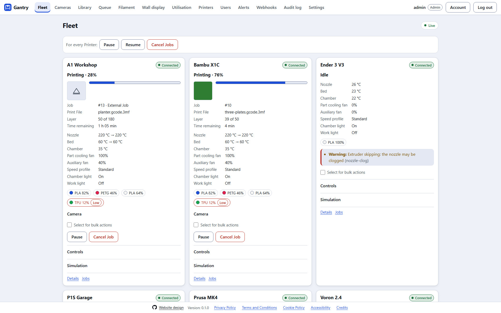
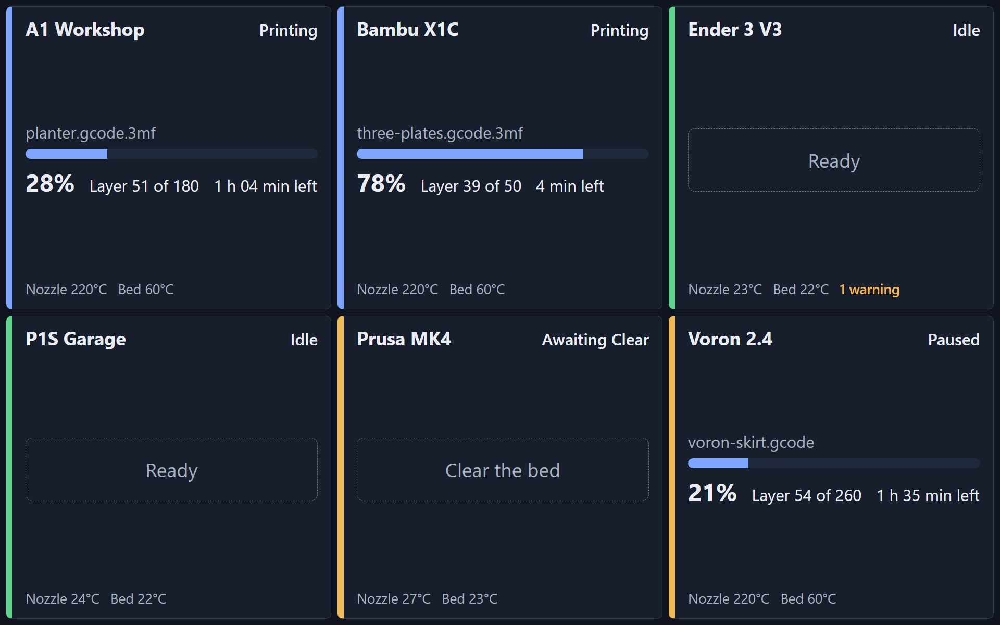
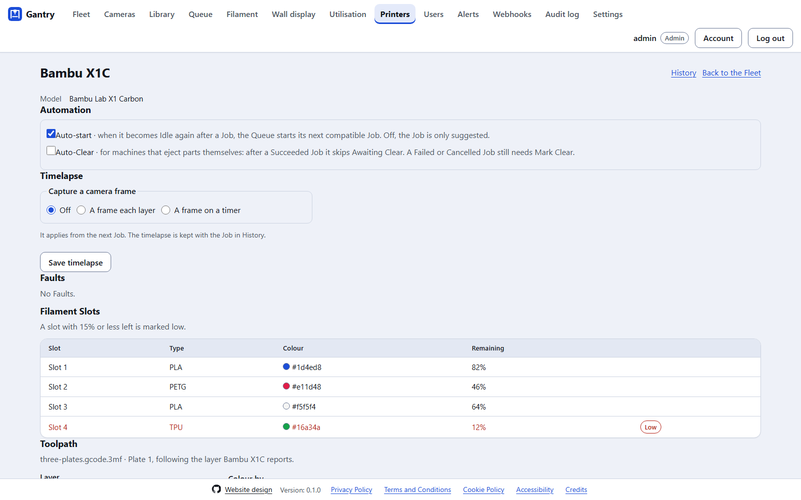
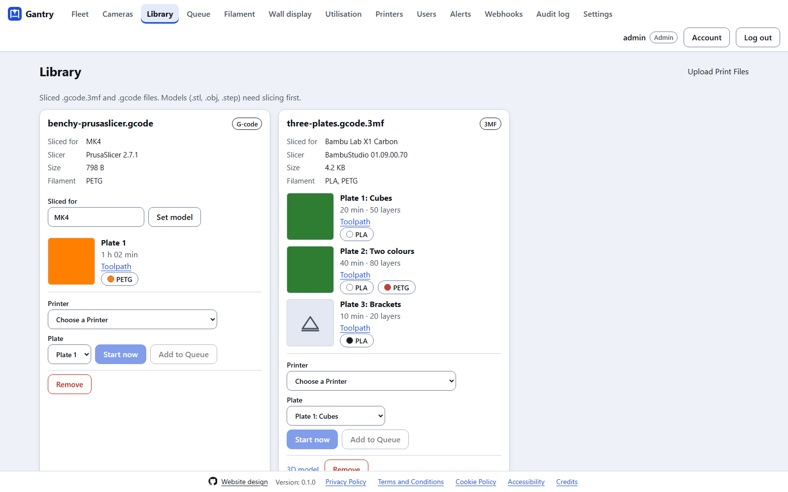
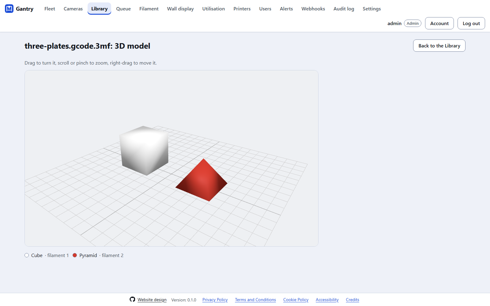
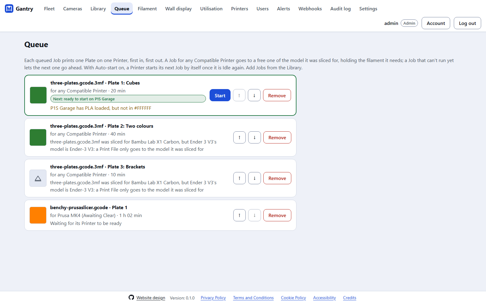

# What Gantry does

Gantry is a self-hosted dashboard for monitoring and controlling a Fleet of 3D printers from one screen. It is a single Rust binary that runs on an always-on machine on your home or workshop network (a Raspberry Pi, mini PC or NAS). It talks to each printer over the LAN and serves a login-protected website, so you can watch and control every printer from any browser, at home or away.

## Live status

- **Every Printer on one screen:** Connection, Printer State, progress, layer, time remaining, temperatures (with targets), fans, lights, speed profile, Filament Slots and Faults, plus a camera view on each card. Everything updates live over a WebSocket.
- **A camera grid** (**Cameras**) shows every Printer's camera at once, with a quality choice per browser. Remote viewing streams only while someone is watching, downscaled to suit home upload bandwidth.
- **Faults** are listed by severity on each card and on the Printer's **Details** page. Filament Slots below the threshold under **Settings** are marked low.
- **The wall display** (**Wall display**) is a read-only, full-screen view for a workshop monitor: big type, each Printer's state, progress and temperatures, and what needs doing (*Clear the bed*).

## Control

- **Pause, resume and Cancel**, with confirmation before a Cancel.
- **Fine controls:** temperatures, lights, fans, speed profiles, homing, jogging and filament load and unload, where the Printer's Driver supports them. A Printer whose firmware blocks control keeps showing live status, and Gantry hides the controls it can't use. An Admin can override what a Printer is believed capable of.
- **Bulk actions:** select Printers on the Fleet page and pause, resume or Cancel them together. Each Printer's result is reported separately.

## Print Files and the Queue

- **A Print File library** (**Library**): upload sliced `.gcode.3mf` and `.gcode` files. Each Plate shows its thumbnail, estimated time, layers and filament. Models (`.stl`, `.obj`, `.step`) need slicing first: Gantry does not slice.
- **A 3D model viewer** for each Print File, and a **toolpath preview** for each Plate that follows the layer a Printer is printing.
- **Send a Plate** to a Printer of the model it was sliced for, or add it to the Queue.
- **The Queue** (**Queue**): each Job prints one Plate on one Printer, first in, first out. A queued Job either names a Printer or runs on any **Compatible Printer**: one of the model it was sliced for, loaded with the filament it needs. A Job that can't run yet lets the next one go ahead.
- **Awaiting Clear and Mark Clear:** after every Job a Printer waits in *Awaiting Clear* until an Operator uses **Mark Clear**, so nothing is ever printed onto a finished part. **Auto-Clear** skips this after a Succeeded Job, for machines that eject parts themselves.
- **Auto-start:** when a Printer becomes Idle, the Queue starts its next compatible Job by itself (on by default per Printer), or only suggests it.

## History, analytics and timelapses

- **History:** every Job's Outcome (Succeeded, Failed, Cancelled or Lost), when it started and ended, its duration, filament and cost, per Printer, with success and failure rates.
- **Filament** is the spool inventory, used to cost each Job.
- **Utilisation** charts how each day was spent (printing, Awaiting Clear, idle, busy, disconnected) and uptime, for one Printer or the whole Fleet.
- **Timelapses:** optionally a frame from the Printer's camera each layer, or on a timer, attached to the Job in History.
- **Retention:** Job History is kept forever. What's cleaned up is stored files: when the Print File library passes its size limit (under **Settings**), the oldest files no Job still needs are removed.

## Alerts and integrations

- **Alerts** through ntfy, Discord, email (SMTP), Telegram and desktop notifications (in the desktop app), set up as Fleet-wide **Alert Rules** under **Alerts**.
- **A REST API** with an OpenAPI document at `/api/openapi.json` and **API tokens** that carry their owner's role ([the REST API](rest-api.md)).
- **Signed webhooks** for the same events as Alerts ([webhooks](webhooks.md)).
- **Prometheus metrics** at `/metrics`, off by default ([metrics](metrics.md)).
- **Config export and import:** Admins export the Printers and settings as a Git-friendly TOML file (credentials only if asked for) and import one, with a preview of every change before it is applied.

## Finding Printers

Bambu, Moonraker and OctoPrint Printers on the LAN are found automatically (SSDP and mDNS) and offered to an Admin to add under **Printers**, with what was found filled in.

## Accounts and security

A login is always required, with Viewer, Operator and Admin roles, TOTP two-factor authentication, passkeys, lockouts and an audit log. See [Security](security.md).

## Accessibility and appearance

Built to WCAG 2.2 Level AA: keyboard, screen readers, 400% zoom, reduced motion and forced colours, checked by axe-core on every page. Light, dark or System mode (the default) and six themes, chosen per browser under **Settings**. Every page has a footer with the Privacy Policy, Terms, Cookie Policy, Accessibility statement and Credits.

A shared Gantry link shows a title, description and image on social sites and chat apps (set `public_url`, see [remote access](remote-access.md#link-previews)).

## The desktop app

A Tauri app for Windows, macOS and Linux that connects to your Gantry server, or runs Gantry itself on one machine, with desktop Alerts as native notifications ([the desktop app](desktop.md)).

## What Gantry doesn't do

Gantry does **not** slice models, use any printer vendor's cloud, or host other people's fleets. It is a personal, single-Fleet tool ([ADR-0001](architectural-decision-record/0001-personal-single-fleet-scope.md)).
