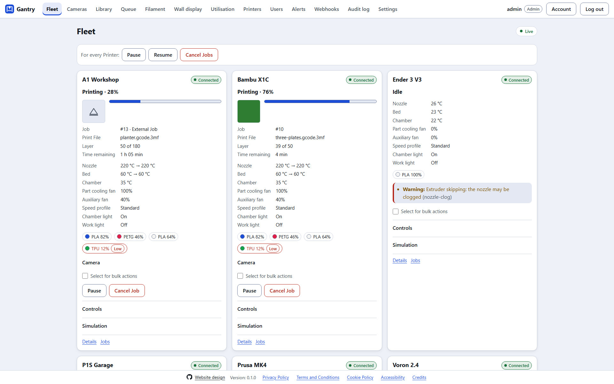
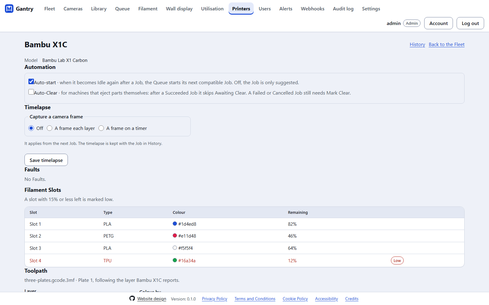
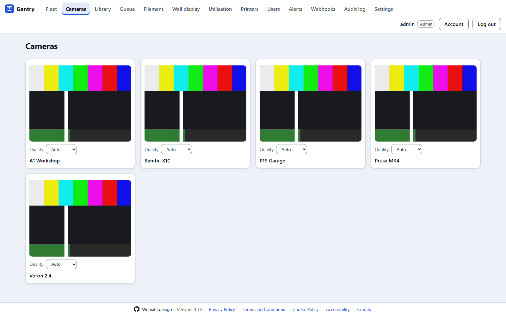
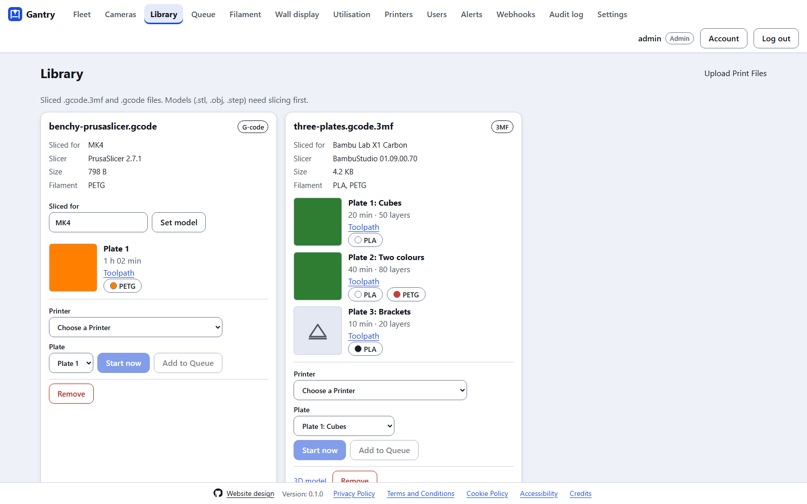
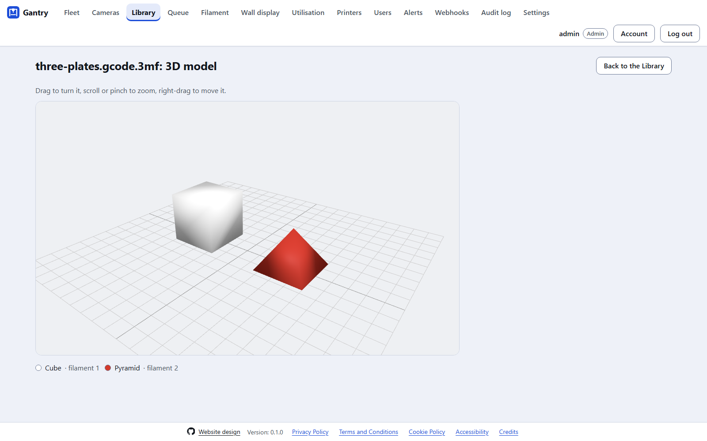
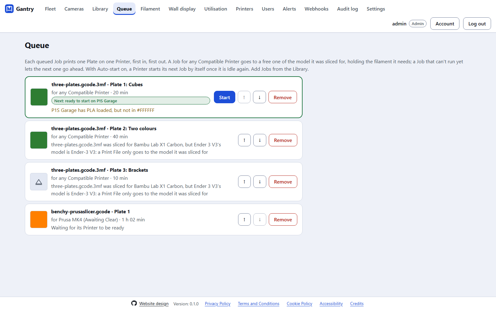
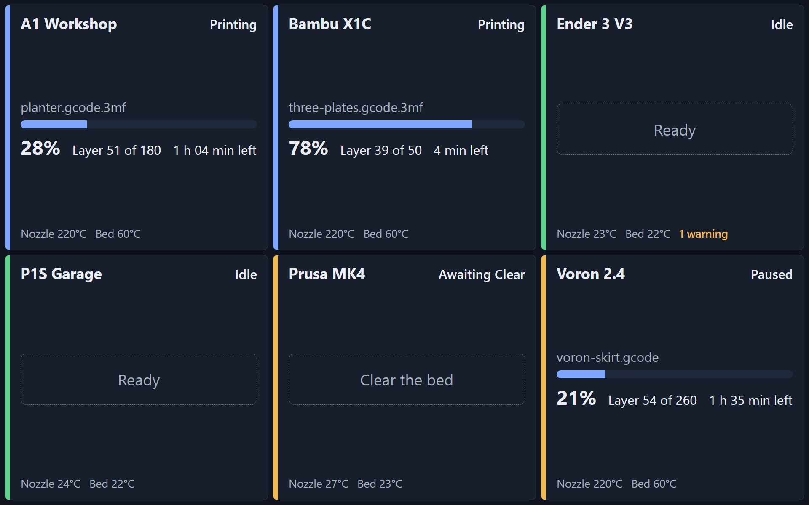

# Using Gantry

A tour of every page, and who can use it. Roles are enforced by the server on every route, not only hidden in the UI ([security](security.md)).

| Page | What it's for | Who |
|---|---|---|
| **Fleet** | Every Printer's live card, and bulk actions | Everyone sees; Operators control |
| **Cameras** | Every camera at once | Everyone |
| **Library** | Print Files, Plates, the 3D viewer and toolpath preview | Everyone sees; Operators upload and send |
| **Queue** | Jobs waiting for a Printer | Everyone sees; Operators manage |
| **Filament** | The spool inventory | Everyone sees; Operators manage |
| **Wall display** | A read-only full-screen view | Everyone |
| **Utilisation** | How each day was spent, and uptime | Everyone |
| **Printers** | Adding, editing and removing Printers, and Tags | Admins |
| **Users** | Accounts, roles, unlocking, resetting two-factor | Admins |
| **Alerts** | Alert channels and Alert Rules | Admins |
| **Webhooks** | Signed webhooks | Admins |
| **Audit log** | Every state-changing action | Admins |
| **Settings** | Appearance, automation, thresholds, config export and import | Everyone chooses appearance; Admins the rest |
| **Account** | Your password, two-factor, passkeys and API tokens | Everyone |

## The Fleet

Each Printer has a card with its Connection, Printer State, progress, layer, time remaining, temperatures, fans, lights, speed profile, Filament Slots, Faults and camera. Operators pause, resume and Cancel from the card, and open **Controls** for temperatures, fans, lights, speed, homing, jogging and filament load and unload. A Printer that has finished a Job shows **Mark Clear**: press it once the bed is empty.

To act on several Printers at once, tick **Select for bulk actions** on each, then use **For every Printer** at the top. Each Printer's result is shown separately. Admins create Tags under **Printers** and attach them, and the Fleet page filters by them.

A Printer's **Details** page lists its Faults by severity and its Filament Slots, marked low below the threshold set under **Settings**, and turns **Auto-start**, **Auto-Clear** and its **timelapse** on and off. **Jobs** is its History: every Job, its Outcome, duration, filament and cost, and success rates.

## Cameras

Every Printer's camera at once. The quality is chosen per camera and kept in this browser. Cameras stream only while someone is watching.

## The Library

Upload sliced `.gcode.3mf` and `.gcode` files with **Upload Print Files**. Each Print File shows the printer model it was sliced for, the slicer, size and filament, and each Plate its thumbnail, time, layers and filament. If the slicer named the model differently from your Printer, correct it with **Sliced for**.

- **3D model** opens an interactive viewer: drag to turn it, scroll or pinch to zoom, right-drag to move it.
- **Toolpath** previews a Plate layer by layer, coloured by feature, and can follow the layer a Printer is printing.
- Choose a **Printer** and **Plate**, then **Start now**, or **Add to Queue**. A Plate only goes to a Printer of the model it was sliced for.

## The Queue

Each queued Job prints one Plate on one Printer, first in, first out. A Job for **any Compatible Printer** goes to a free one of the model it was sliced for, holding the filament it needs; a Job that can't run yet lets the next one go ahead, and says why it's waiting. Reorder Jobs with the arrows, or start one by hand with **Start**.

With **Auto-start** on (the default), a Printer starts its next Job by itself once it is Idle again; off, the Job is only suggested. A Printer only becomes Idle after **Mark Clear**, unless **Auto-Clear** is on for it (for machines that eject their parts): then a Succeeded Job skips Awaiting Clear. A Failed or Cancelled Job always needs Mark Clear.

## Filament and Utilisation

**Filament** is the spool inventory: material, colour, weight and cost, used to cost each Job in History. **Utilisation** charts how each day was spent (printing, Awaiting Clear, idle, busy, disconnected) for one Printer or the whole Fleet, with utilisation and uptime totals.

## The wall display

A read-only, full-screen view for a workshop monitor or TV: large type, each Printer's state, progress and temperatures, and what needs doing. Log in as a Viewer on the machine that shows it.

## Alerts and webhooks

Under **Alerts**, Admins add channels (ntfy, Discord, email over SMTP, Telegram, and desktop notifications for [the desktop app](desktop.md)) and the **Alert Rules** that use them: which events (a Job finishing or failing, a Fault, a Printer disconnecting, filament running low and so on), for which Printers. **Test** sends a test message. Under **Webhooks**, Admins send the same events, signed, to any URL ([webhooks](webhooks.md)).

## Settings

- **Appearance:** Light, Dark or System mode and one of six themes, per browser.
- **Automation and thresholds:** the low-filament threshold, the Print File library's size limit, and other Fleet-wide defaults.
- **Configuration:** export the Printers and settings as a Git-friendly TOML file (credentials only if asked for), and import one, with a preview of every change before it is applied in one go.

## Account

Change your password, turn on two-factor authentication (TOTP) with recovery codes, add passkeys, and create API tokens for [the REST API](rest-api.md). An API token acts with your role and can be revoked at any time.

## Simulated Printers

A Simulated Printer's card has a **Simulation** panel, for Admins: start and fail prints, change the simulation's speed, raise and clear Faults, drop and restore the connection, and load filament. It drives the whole dashboard, Queue and Alerts flow with no hardware.
